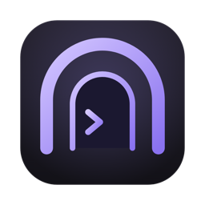
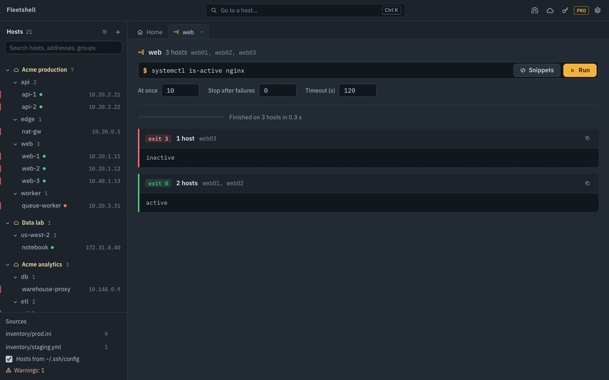
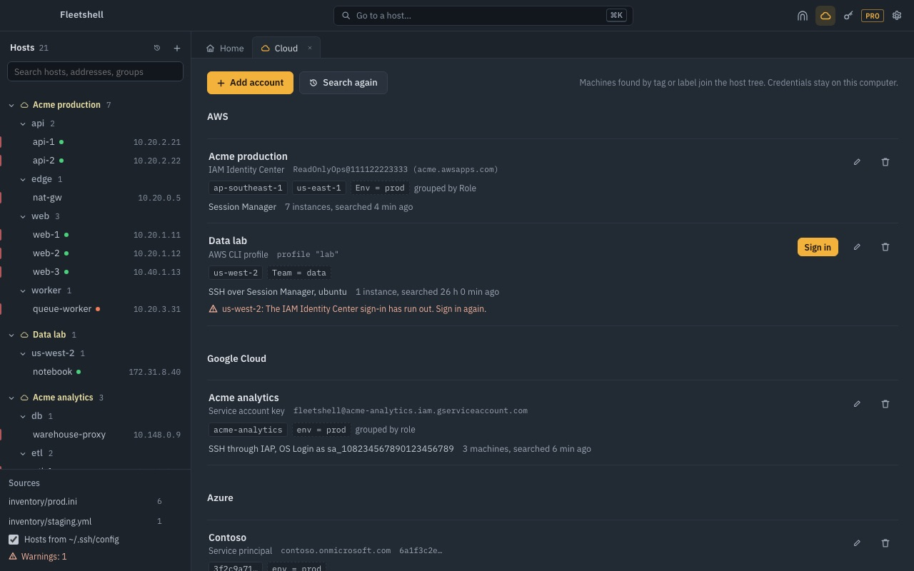
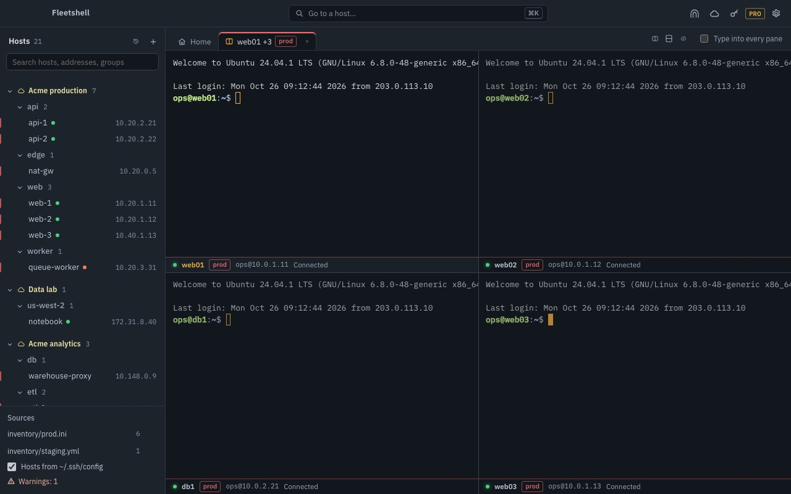
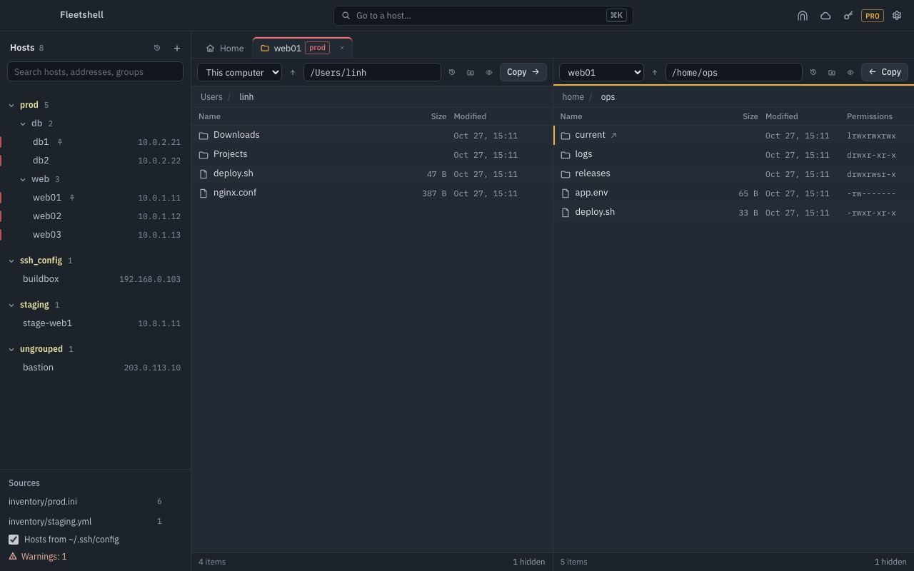
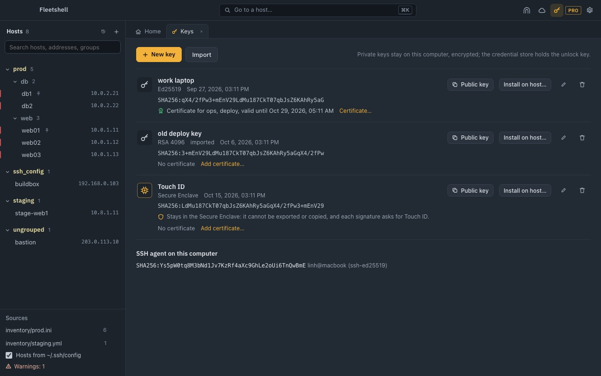

<h1 align="center">Fleetshell</h1>

Terminal, files and tunnels for the servers you run, straight from your Ansible inventory. 
macOS, Windows and Linux. English and Vietnamese.

<a href="https://fleetshell.richardpham.com">Website</a> · <a href="https://fleetshell.richardpham.com/vi/">Tiếng Việt</a> · <a href="https://fleetshell.richardpham.com/help">Help</a> · <a href="https://github.com/fleetshell/fleetshell/releases">Releases</a>

Fleetshell reads the Ansible inventory and `~/.ssh/config` you already keep and shows each host in its group. Open a terminal, a file pane or a tunnel from there, or ask a whole group one question and read the answers side by side.

## What it does

- **Your inventory is the host list.** INI and YAML inventories with `group_vars` and `host_vars`, plus `~/.ssh/config`. Groups, users, ports and jump hosts come with them, and edits to the files show up in the tree.
- **One command, a whole group** (Pro). Hosts that answered the same are folded into one row, failures come first, and a run stops after as many errors as you allow.
- **Cloud machines with no port 22 open** (Pro). AWS EC2 through Session Manager, Google Cloud VMs through Identity-Aware Proxy with OS Login, Azure VMs through Azure Bastion, found by tag or label.
- **Terminals the way you work.** Tabs and split panes that come back when you reopen the app, search in the scrollback, a warning before pasting several lines, snippets with variables and per-host history.
- **Files side by side.** Two SFTP panes, resumable transfers, and editing a remote file without overwriting someone else's change.
- **Tunnels that stay up.** Local, remote and SOCKS forwards that reconnect after sleep or a Wi-Fi change.
- **Keys that stay on your computer.** Encrypted keys unlocked through the system keychain, OpenSSH certificates, and on a Mac (Pro) keys in the Secure Enclave that ask for Touch ID.
- **Light or dark, your layout.** Five accent colours or your own, and four layouts: classic tree, icon rail, tabs only, or the host's details docked beside your work.

Host keys you have not seen are shown for you to compare; a changed key is refused. Fleetshell has no account, no analytics and no server of its own.

| | |
|---|---|
|  |  |
|  |  |

## Get it

| Platform | Where | Status |
|---|---|---|
| macOS | Mac App Store | In review |
| Windows | Microsoft Store | Coming soon |
| Linux | Snap Store, `.deb` and `.tar.gz` on [Releases](https://github.com/fleetshell/fleetshell/releases) | Coming soon |

Free to start; Pro is a one-time $9.99 purchase. Fleetshell 2.0 succeeds SSH Tunnel Manager: saved tunnels and trusted host keys carry over.

## Help and feedback

- Questions and how-tos: [fleetshell.richardpham.com/help](https://fleetshell.richardpham.com/help)
- Bugs and ideas: [open an issue](https://github.com/fleetshell/fleetshell/issues) here. Leave out passwords, keys and host names you would rather keep private.
- Email: support@richardpham.com

This repository holds releases and the issue tracker; the app's source is not public.

[Privacy Policy](https://fleetshell.richardpham.com/privacy-policy) · [Terms of Service](https://fleetshell.richardpham.com/terms-of-service) · © 2026 Richard Pham
